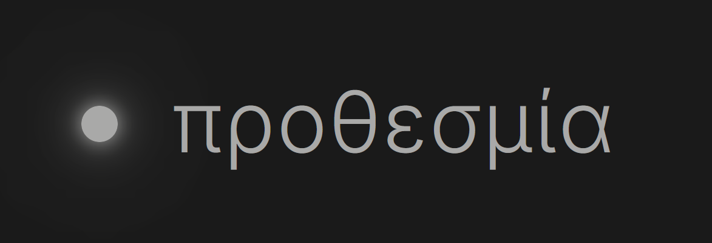

// προθεσμία / prothesmia 


it's a simple pomodoro timer. rather clean relative to ones usually available, and heavy on customsations. there's no specific framework or backend, just plain html/css/js, and all your cusotm configs stay in your browser's localstorage.

the timer itself is the usual shape. focus, short break and long break each get their own duration, a long break arrives after however many focus sessions you choose, and the next session can start on its own if you'd rather bother clicking. switching between modes pauses the one you were in and remembers where it stopped, so peeking at a break doesn't cost you your progress. you can rename the caption under the ring.

most of the work went into appearance. there are four presets: mono / noir / paper / dusk, and you can recolor the focus and break rings on top of any of them. three button styles: translucent, opaque, and a retro one with seven-segment digits and little indicator lights. you can put up custom background images / youtube videos, with custom opacity and dark overlay, though that only works with the translucent buttons. the timer elements can be dragged and resized wherever you like, and there's a small notes widget that supports basic markdown.

audio works the same way, as a set of things you can turn on. the background video can have its own volume, you can import an audio file to loop, and a youtube card will play a video or a whole playlist with a seek bar and previous and next buttons. 

to run it locally, any static file server will do:
```
python -m http.server 9999
```
then open localhost:9999. the page is index.html, the timer logic and page wiring, all in app.js. storage / themes / settings panel / audio config in shared.js, styles.css - css obviously.

two things: the timer's progress isn't saved across reloads, though your settings, theme, notes and audio choices are. and uploaded images and audio are stored as data urls, so a very large file can run past the browser's localstorage quota.

PRs are welcome.
