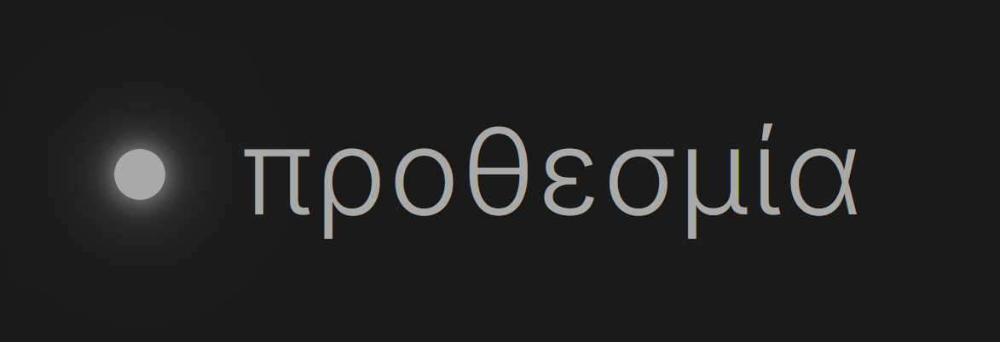

a dumb-simple discord bot + devvit app which embeds custom countdown cards for events / exams. that's it.

προθεσμία is greek for deadline.

site: [prothesmia.xyz](https://prothesmia.xyz)  
discord: [add the bot](https://discord.com/oauth2/authorize?client_id=1567004871859904724&scope=bot%20applications.commands&permissions=117760)  
reddit: [developers.reddit.com/apps/prothesmia](https://developers.reddit.com/apps/prothesmia)  
[terms](https://prothesmia.xyz/terms/) / [privacy](https://prothesmia.xyz/privacy/)

## what's in here

- `bot/` - the discord bot. plain node, no framework. it takes slash commands over http and edits an embed on a schedule
- `devvit/` - the reddit app. devvit web, typescript. a custom post that draws the card in realtime
- `site/` - prothesmia.xyz. plain html, css and js, deployed by github pages from `.github/workflows/pages.yml`

the two cards do indeed look alike, but the discord one is drawn as a png and attached to an embed and the reddit one is simple html, css and svg.

## discord bot

1. invite the bot to your server
2. in the channel you want, use `/countdown set` with your config
3. leave it. the embed edits itself on the interval you set, 1 to 24 hours

it needs `view channels`, `send messages`, `embed links`, `attach files` and `read message history`, and uses no privileged intents. the channel can stay read-only. commands need the `manage server` permission. several countdowns can share a channel.

commands

- `/countdown set` - post or replace a countdown in this channel
- `/countdown configure` - change settings on one that already exists
- `/countdown list` - lists every countdown set server-wide with its config
- `/countdown remove` - delete a countdown and its card
- `/help` - lists these commands

config

- `label` - the title, for example `JEE Main 2027`
- `date` - written like `2027-01-04 09:00`
- `timezone` - an IANA name such as `Asia/Kolkata`; defaults to `UTC`
- `start` - when the countdown began, before the date; optional. the ring fills gradually from `start` if set
- `tag` - small text in the top corner, `none` to hide
- `fields` - beside the ring: `target`, `timeLeft`, `elapsed`, or `none` for just the ring
- `thumbnail` - an image url for the top-right corner of the embed
- `dimensions` - `tall` (default) / `compact`
- `ring` - `default` / `pride` / `trans`
- `interval` - hours between updates, `1` to `24`; defaults to `1`
- `schedule` - `now` / `start` / `custom`
- `post_at` - the post time for a custom schedule (has to be before the set-date)
- `bump` - bool. sends and prunes a random text to mark the channel unread on set interval
- `bump-interval` - bump-rate, `1` to `168`; defaults to `24`

a bump sends one message at random from a fixed list in `bot/src/bump.js`. it's `false` unless you explicitly set it `true`

## reddit app

posts a custom countdown card / embed for a set date. visually similar to the discord embed; a few optional fields; a live d:h:m:s clock if you want one.

1. any mod with `everything` privileges can add it to their community
2. in the subreddit's mod menu, select `create countdown post`
3. set custom config through the community's installed apps' settings - the post updates accordingly

the countdown post self-pins in the first slot. an optional scheduled thread, with the days left in the title, pins under it. both are posted by the application itself.

settings

- `events` - `name | event date | countdown start`, separated by `;`. the start is optional
- `timezone` - an IANA name, `Asia/Kolkata` by default
- `ring styles` - default, pride or trans
- `card size` - tall, compact or desktop. avoid desktop if most of your members use the phone client
- `fields` - target, time left, elapsed. deselect all for just the ring
- `tag` - small text in the top corner, `none` to hide
- `live clock` - days, hours, minutes and seconds under a smaller ring
- `countdown post title` - used when a mod creates the post
- `scheduled thread` - on or off, the hour, a title and a text. placeholders `{days}`, `{event}` and `{date}`

reddit has approved it for the public listing, so any mod can add it from its app page. more in devvit/README.md.

## selfhost

the bot needs node 22.9 or newer, a discord application, and a [turso](https://turso.tech) database. set these, in your host or a `bot/.env` (ignored by git):

```
DISCORD_TOKEN
DISCORD_APP_ID
DISCORD_PUBLIC_KEY
TURSO_URL
TURSO_TOKEN
```

```
cd bot
npm install
npm run register
npm start
```

- `npm run register` registers `/countdown` and `/help` with discord
- set the application's interactions endpoint url to `https://your-host/interactions`
- `/health` answers `ok` and checks for due refreshes, so ping it every few minutes if your host sleeps. it also checks every 5 minutes on its own
- the table is created on first start
- `npm run preview` draws sample cards into `bot/out/`

the reddit app needs node 24 or newer and a subreddit you moderate.

```
cd devvit
npm install
npm run login
npm run dev
```

- `npm run dev` playtests on that subreddit
- `npm run check` and `npm test` check types and logic, `npm run build` builds
- `npm run deploy` uploads a version, `npm run launch` sends it to reddit for review

the site is static. serve `site/` with anything, for example `python3 -m http.server` inside it. pushing a change under `site/` to `main` deploys it.

## privacy and terms

it keeps only what it needs to show a countdown. no accounts, no ads, no tracking, nothing sold. the discord bot stores each countdown's server and channel ids, label, dates and card options. the reddit app keeps two small values in reddit's own storage. the full list is on the [privacy page](https://prothesmia.xyz/privacy/).

it's a hobby project on free hosting, provided as is. it can be slow, restart or stop without notice, so don't rely on it as your only reminder for an exam or a deadline. the [terms](https://prothesmia.xyz/terms/) are short.

## license

[MIT](LICENSE).

## contact

open an issue, or mail [hey@nielandvoid.com](mailto:hey@nielandvoid.com).

the pomodoro tool that was previously hosted at prothesmia.xyz is now at [klepsydra](https://github.com/nielandvoid/klepsydra) and is named klepsydra / κλεψύδρα `/kleˈpsiðra/`.
